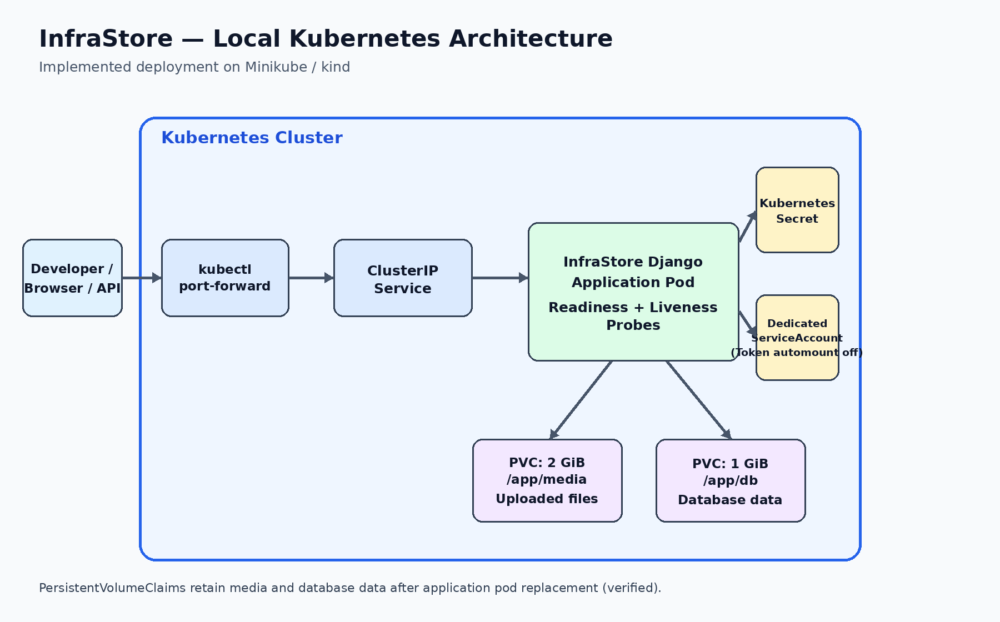
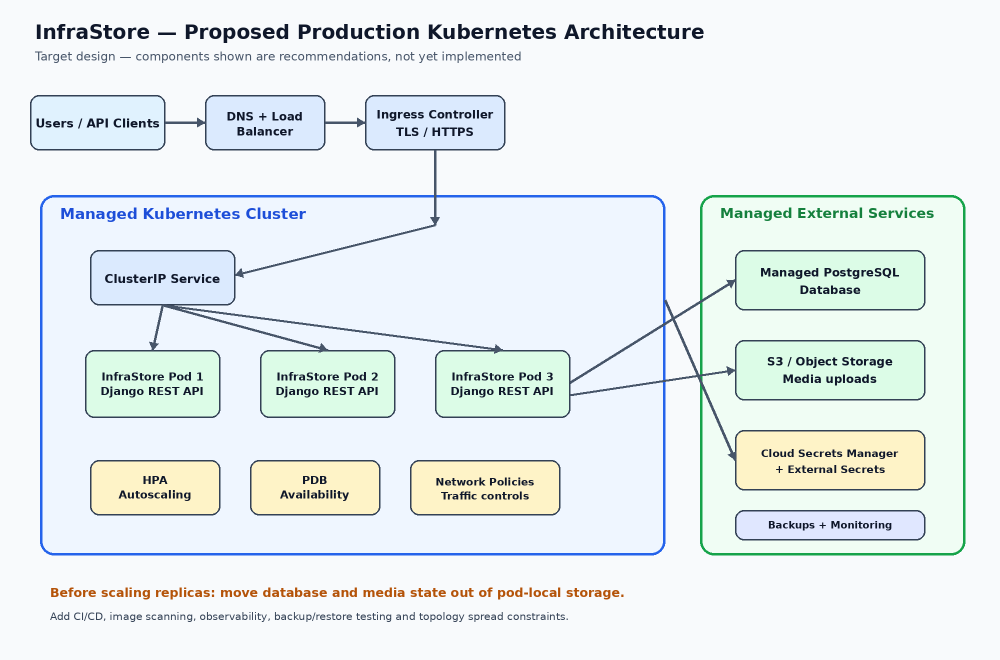

InfraStore – Kubernetes Deployment

Overview:

This project demonstrates the deployment of InfraStore, a Django-based REST API application, on Kubernetes using Helm.
The goal was to create a repeatable deployment with persistent storage, secure configuration, resource management and a foundation for future scalability.
I chose Helm over maintaining standalone Kubernetes manifests because it provides reusable templates, configurable values and a cleaner deployment lifecycle.

The solution is designed to run locally on Minikube, kind or another Kubernetes cluster without requiring a cloud provider.

1. Architecture:

Components:

Component	Implementation
Container	infratestchallenge/infrastore
Orchestration	Kubernetes
Packaging	Helm 3
Application	Deployment
Networking	ClusterIP Service
Credentials	External Kubernetes Secret
File storage	PersistentVolumeClaim
Database storage	PersistentVolumeClaim
Security	Dedicated ServiceAccount, seccomp and container hardening
Health checks	Readiness and liveness probes
Deployment strategy	RollingUpdate

2. Repository structure:

kuberenetes/
├── README.md
├── docs/
│   └── images/
│       ├── local-kubernetes-architecture.png
│       └── production-kubernetes-architecture.png
├── helm/
│   └── infrastore/
│       ├── Chart.yaml
│       ├── values.yaml
│       └── templates/
│           ├── _helpers.tpl
│           ├── deployment.yaml
│           ├── service.yaml
│           ├── pvc.yaml
│           ├── secret.yaml
│           ├── serviceaccount.yaml
│           ├── hpa.yaml
│           ├── pdb.yaml
│           └── ingress.yaml
├── persistence-test.txt
├── test-infrastore.txt
└── test.txt

The Helm chart contains the application deployment and its supporting resources.

3. Design decisions:

Application deployment
The application runs as a Kubernetes Deployment with one replica.
A rolling update strategy is configured with:

maxSurge: 1
maxUnavailable: 0

This allows Kubernetes to create a replacement pod before terminating the previous pod, subject to available cluster resources and readiness.
I kept the replica count at one because the supplied application uses local database and filesystem paths. Increasing replicas without externalizing state could cause data consistency and availability issues.

Persistent storage
Two PersistentVolumeClaims are used:

Mount path	Purpose	Requested size
/app/media	Uploaded files	2Gi
/app/db	Database files	1Gi

Persistent volumes allow application data to survive ordinary pod replacement.
PVCs are deliberately managed separately from application lifecycle operations. Removing a Helm release should not be treated as a data deletion procedure.

Secret management
Administrator credentials are managed outside Helm using a Kubernetes Secret.
The Deployment references the Secret through secretKeyRef.
The chart supports two modes:

An externally managed Secret using existingSecret.
A Helm-managed Secret when no external Secret is configured.

For this deployment, I use the external Secret approach to keep credentials out of Helm values.
Refer to Step 2 in the deployment instructions for the creation command.

ServiceAccount and RBAC
A dedicated ServiceAccount is created for InfraStore.
Automatic service-account token mounting is disabled:

yaml
automountServiceAccountToken: false

The application does not require Kubernetes API access, so no application-level Role or RoleBinding is created.
Deployment and Secret management permissions are handled separately.
This follows the principle of least privilege.

Container security
The current deployment includes:
Privilege escalation disabled.
All Linux capabilities dropped.
RuntimeDefault seccomp profile.
Kubernetes Secret references for credentials.
CPU and memory requests and limits.
Non-root execution and read-only root filesystem are potential improvements, subject to validating compatibility with the supplied image.

Resource management
The current resource configuration is:
Resource	Request	Limit
CPU	250m	1
Memory	256Mi	512Mi
These are initial values for a local deployment, not production capacity guarantees.

4. Deployment instructions:

Prerequisites:
Kubernetes cluster (Minikube, kind or k3s).
kubectl.
Helm 3.
A working StorageClass.
Check the environment:
minikube start
kubectl get nodes
kubectl get storageclass
helm version

Step 1 – Create namespace
kubectl create namespace infrastore \
  --dry-run=client -o yaml | kubectl apply -f -

Step 2 – Create application Secret

read -rsp "Enter admin password: " DJANGO_SUPERUSER_PASSWORD
echo

kubectl create secret generic infrastore-secret \
  -n infrastore \
  --from-literal=DJANGO_SUPERUSER_USERNAME=admin \
  --from-literal=DJANGO_SUPERUSER_PASSWORD="$DJANGO_SUPERUSER_PASSWORD" \
  --dry-run=client -o yaml | kubectl apply -f -

unset DJANGO_SUPERUSER_PASSWORD

Enter the administrator password when prompted.

Step 3 – Install using Helm
From the repository root:
helm upgrade --install infrastore ./helm/infrastore \
  --namespace infrastore \
  --set existingSecret=infrastore-secret \
  --wait \
  --timeout 5m

Helm creates or updates the application resources and references the existing Kubernetes Secret.

Step 4 – Verify deployment
helm status infrastore -n infrastore
kubectl get pods -n infrastore
kubectl get svc -n infrastore
kubectl get pvc -n infrastore
kubectl get serviceaccount -n infrastore
kubectl rollout status deployment/infrastore -n infrastore

5. Application connectivity and API testing:

Forward the Kubernetes Service to the local machine:
kubectl port-forward -n infrastore svc/infrastore 8000:80

The application is then available at:
http://localhost:8000
The API endpoints are:

Method	Endpoint	Purpose
POST	/api/token/	Obtain authentication token
POST	/api/upload/	Upload a file
GET	/api/files/	List stored files
DELETE	/api/files/<id>/	Delete a file

Obtain a token:
curl -X POST http://localhost:8000/api/token/ \
  -d "username=admin&password=YOUR_PASSWORD"

Use the returned token:
curl http://localhost:8000/api/files/ \
  -H "Authorization: Token YOUR_TOKEN"

Upload a file:
curl -X POST http://localhost:8000/api/upload/ \
  -H "Authorization: Token YOUR_TOKEN" \
  -F "file=@persistence-test.txt"

Delete a file:
curl -X DELETE http://localhost:8000/api/files/1/ \
  -H "Authorization: Token YOUR_TOKEN"

6. Validation and testing:
The following checks were performed during implementation:

Test	Status
Helm chart linting	Passed
Helm template rendering	Passed
Deployment manifest validation	Passed
External Secret reference rendering	Passed
ServiceAccount creation	Verified
ServiceAccount token automount disabled	Verified
Kubernetes Service connectivity	Verified
Application HTTP response	Verified
API authentication	Requires valid existing Django credentials
File upload and deletion	Verified
Persistence after pod restart	Verified

7. Production architecture and future improvements:

The current solution is suitable as a local Kubernetes deployment. Before using it in production, I would make the following architectural changes.
Planned improvements
Area	Current implementation	Production approach
Application	Single replica	Multiple replicas
Database	Local database files	Managed PostgreSQL
File storage	PersistentVolumeClaim	S3-compatible object storage
Scaling	Manual	Horizontal Pod Autoscaler
Secrets	Kubernetes Secret	External Secrets Operator
Networking	ClusterIP	Ingress with TLS
Availability	Single application replica	Multi-replica deployment and PDB
Monitoring	kubectl logs	Prometheus, Grafana and centralized logging
Backups	Not automated	Scheduled backups and recovery testing
Why externalize the database and file storage?

The current application stores its data locally. Simply increasing the replica count would not provide reliable horizontal scalability.
For production, I would first migrate the database to PostgreSQL and uploaded files to object storage.
This would allow multiple stateless application pods to serve requests consistently.

I would also introduce:
NetworkPolicies.
Restricted RBAC for deployment identities.
Encryption of Kubernetes Secrets at rest.
Image scanning and immutable image tags.
Pod topology spread constraints.
Automated database and file backups.
Monitoring, alerting and centralized logging.
CI/CD with Helm validation and deployment rollback.

Additional Helm Templates and Validation Scope:
The Helm chart includes templates for Horizontal Pod Autoscaler (HPA), Pod Disruption Budget (PDB), and Ingress.
These templates demonstrate how the deployment can be extended for production requirements.
Due to the limitations of the local Minikube environment, these configurations have not been fully validated.
They should be tested in a suitable Kubernetes environment with the required metrics provider, Ingress controller and supporting configuration before production use.
The currently deployed single-replica application, persistent storage, Service and security configurations were validated locally.

8. Operational commands:

View application logs:
kubectl logs deployment/infrastore -n infrastore

Check deployment status:
kubectl rollout status deployment/infrastore -n infrastore

Upgrade:
helm upgrade infrastore ./helm/infrastore \
  --namespace infrastore \
  --reuse-values

Rollback:
helm history infrastore -n infrastore
helm rollback infrastore 1 -n infrastore

Uninstall:
helm uninstall infrastore -n infrastore

PVCs and externally managed Secrets should be reviewed separately before cleanup.

Conclusion:

I used Helm to create a repeatable Kubernetes deployment while keeping application configuration, credentials and persistent storage separate.
The current implementation provides a working deployment foundation with persistent volumes, external Secret management, a dedicated ServiceAccount, container security controls, resource limits and health probes.
The most important production improvement is to externalize state before introducing horizontal scaling.
My approach was to deliver a practical local deployment first, while keeping the architecture ready for a more scalable and secure production environment.